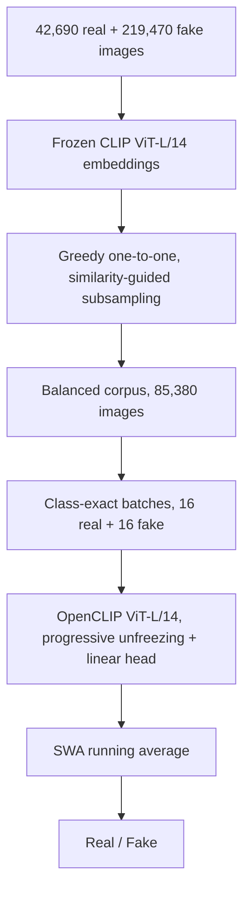

`openclip` `vit` `pytorch` · Oct 2024 – Jan 2025 · **Status: Complete (arXiv preprint)**

[GitHub →](https://github.com/DarkJ0Y/PairCLIP-SWA) · [arXiv:2610.37874 →](https://arxiv.org/abs/2610.37874)

## Overview

**PairCLIP-SWA** is a deepfake image detector built on a single OpenCLIP ViT-L/14 backbone. It was trained and tested on the IEEE SP Cup 2025 (DF-Wild-Cup) benchmark, where it reaches 97.04% validation accuracy, 98.64% AU-ROC and a 4.07% equal error rate. That beats the strongest published three-backbone ensemble (94.46%, 97.60%, 5.00%) while using one model, one forward pass and about a third of the training images. The work became a paper with Md. Nakib, Sudipto Sarkar and Prof. Mohammad Ariful Haque: *PairCLIP-SWA: Similarity-Guided Balancing and Stochastic Weight Averaging for Generalized Deepfake Image Detection with OpenCLIP* ([arXiv:2610.37874](https://arxiv.org/abs/2610.37874)).

## Problem

Detecting AI-generated images is an adversarial problem: generators keep improving, so a detector needs features that generalize instead of memorizing the artifacts of one generator. A second, quieter problem is how detectors are chosen. They are almost always deployed as the single checkpoint with the best validation score, and nobody checks how reliable that choice is.

## Approach

The detector has three parts:

1. **Class balancing.** The training data is heavily imbalanced: 42,690 real images against 219,470 fake ones. Instead of random undersampling, a frozen CLIP ViT-L/14 embeds all images, and each real image is paired with its most similar unused fake image (greedy one-to-one selection). This gives a balanced 1:1 corpus of 85,380 images.
2. **Partial fine-tuning.** The OpenCLIP ViT-L/14 visual tower is unfrozen progressively, one more block every two epochs, with a linear head (768 to 2) on top. Every batch holds exactly 16 real and 16 fake images, which is the strict mini-batch rule that keeps the imbalance from leaking back in. Images are used as full frames, resized to 224 × 224, with horizontal flips only.
3. **Weight averaging.** Stochastic weight averaging (SWA) averages the weights along the fine-tuning trajectory, starting at epoch 12, so the final model does not depend on one lucky checkpoint.

## System architecture

*The three stages: similarity-guided balancing, partial adaptation with weight averaging, and evaluation.*

## Tech stack

- PyTorch and OpenCLIP (ViT-L/14, OpenAI weights), mixed precision
- AdamW at 1e-4 without weight decay, batch size 32
- Trained and evaluated on Kaggle, 2 × NVIDIA T4
- Datasets: IEEE SP Cup 2025 (DF-Wild-Cup), and an OpenForensics-derived real/fake set for the held-out test

## Results

On the SP Cup 2025 validation set (3,072 images), trained under the same protocol as the strongest published ensemble (CAE-Net):

| Metric | CAE-Net ensemble | PairCLIP-SWA |
|---|---|---|
| Accuracy | 94.46% | **97.04%** |
| AU-ROC | 97.60% | **98.64%** |
| Equal error rate | 5.00% | **4.07%** |
| Backbones / forward passes | 3 / 3 | **1 / 1** |
| Training images used | 262,160 | **85,380** |
| Parameters | **117.4 M** | 304.0 M |

Training accuracy was about 98% against 97% on validation, so the model does not overfit.

*Left: the non-averaged checkpoint swings across 5.34 points of validation accuracy, while the SWA average is never worse and is up to 5.99 points better. Right: the running model overfits (its loss more than doubles), but the average does not.*

**The best checkpoint can be the wrong checkpoint.** On the OpenForensics-derived benchmark, the checkpoint that validation accuracy picks scores 98.43% on validation but only 88.85% on a disjoint test set of 10,905 images, and it rejects 21.1% of genuine photographs. The final SWA model ranks last on validation (97.67%) but scores 94.76% on the test set. The validation-selected checkpoint makes about 2.1 times as many test errors as the one it ranks last.

*Validation ranking and held-out test ranking disagree.*

**What actually drives accuracy.** Twenty-two in-house configurations on the same split show that CLIP pre-training, not ensembling, does the work. Using a face-cropping step first costs about 34 points, and frequency-domain (FFT or wavelet) inputs transfer poorly.

*Left: every configuration on the identical validation split. Right: how different input representations and objectives change validation accuracy.*

## Media

[Read the paper on arXiv →](https://arxiv.org/abs/2610.37874) · [Manuscript PDF →](https://github.com/DarkJ0Y/PairCLIP-SWA/blob/main/paper/main.pdf) · [Code, notebooks and results →](https://github.com/DarkJ0Y/PairCLIP-SWA)

## Challenges

The 5:1 fake-to-real imbalance meant naive batches would push the model toward answering "fake". Similarity-guided one-to-one subsampling and exact 16/16 batches handle it. The harder problem was trust: a single "best" checkpoint turned out to be unstable and, on a second dataset, misleading. That is why the paper recommends choosing checkpoints with per-class criteria measured on the early-stopping split, and why the final model is a weight average.

## What I learned

Validation accuracy alone is a weak way to pick a forensic detector. Strong pre-trained representations beat clever ensembles and hand-made frequency features, and an honest comparison needs the same data and the same protocol on both sides.

## Future work

Not documented yet.

## Related

[[work/projects/brain-tumor-detection-mri|Brain Tumor Detection on MRI Images]] — another applied computer-vision/classification project.
